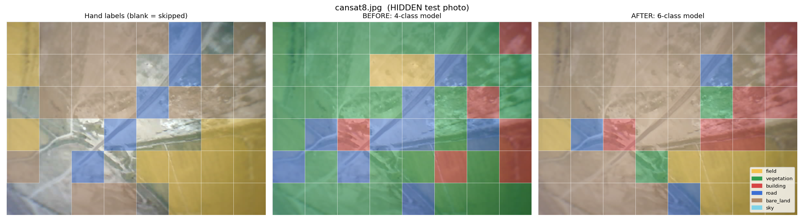
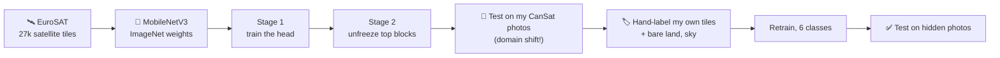

# 🛰️ CanSat Land-Cover Classifier

**Teaching a pretrained MobileNetV3 to read the land from a tiny ESP32-CAM flying under a CanSat.**


<p align="center">
  
</p>

> 👆 Same photo, never seen in training. **Left:** my hand labels. **Middle:** the model trained only on satellite images. **Right:** after I taught it my own scenes.

---

## 🎯 Why I built this

- 📚 It started as a deep-learning course assignment: *fine-tune an ImageNet model on your own images.*
- 🚀 My team flew a CanSat and got aerial photos, and our mentor suggested analysing them after the flight. So instead of a dog-breed dataset, I used **my own flight data**.
- 🧪 I wanted to learn the whole real-world loop, not only `.fit()`: pick data, build the model, debug it, test it on photos it has never seen, and report the weak spots honestly.
- 🧰 It's part of my growing portfolio of ML, computer vision and robotics projects.

## 🗺️ What it does

Cuts a CanSat photo into 100px tiles and colours each tile by what it thinks is there: **field, vegetation, building, road, bare land, sky.**



## 📊 Results

### Part A: satellite data (EuroSAT, 4 classes)

| Model | Validation accuracy | Macro F1 |
|---|---|---|
| Stage 1: only the new head trained | 92.2% | 0.922 |
| Stage 2: top backbone blocks unfrozen | 96.3% (best epoch) | 0.963 |

Stage 2's validation accuracy moved between 91% and 96% from epoch to epoch, so read 96.3% as the best epoch, not the typical one.

### Part B: my CanSat photos (the real exam)

Two photos (`cansat4`, `cansat8`) were **kept completely hidden**: 56 hand-labelled tiles that the model never trained on.

| Class | Hidden tiles | Found | Precision | F1 |
|---|---|---|---|---|
| 🟫 bare land | 28 | 22/28 (79%) | 76% | 0.77 |
| 🟨 field | 21 | 17/21 (81%) | 94% | 0.87 |
| 🟥 building | 2 | 2/2 | 29% | 0.44 |
| 🟦 road | 5 | 1/5 (20%) | 100% | 0.33 |
| 🟩 vegetation, 🩵 sky | 0 | not testable | - | - |

- On tiles of the 4 classes the old model could name: **43% → 71%** accuracy.
- Overall accuracy on the 56 hidden tiles: 75% (always guessing "bare land" gives 50%).
- The old 4-class model scored 21% overall, but it had no `bare_land` or `sky` option, so that comparison is unfair to it. I lead with the 43% → 71% number.

## 🔍 What I learned (the honest part)

- 🌍 **Domain shift is real.** Trained on clean satellite images, the model called almost everything "vegetation" on my blurry ESP32-CAM photos and was confident (0.8-0.9) while wrong. A softmax can't say "none of these".
- 🐛 **My own bug:** fine-tuning with BatchNorm in train mode on *augmented* images made validation accuracy collapse to chance level (about 27-34% with 4 classes). Training accuracy looked fine, which is what made it tricky. Keeping the backbone's BatchNorm statistics frozen fixed it.
- 🏷️ **Labels are the real dataset.** EuroSAT labels one tile with one class even when it contains several things, so some "mistakes" are label noise.
- ⚠️ **Roads got worse after the retrain (4/5 → 1/5).** My dirt roads are pale and look like bare land, and no road tile from my own photos was in training. The old model's 4/5 was flattering too: it painted "road" over many non-road tiles.
- ⚠️ **Buildings are anecdotal.** Only 2 test tiles, and bright salt/rock patches were often mistaken for roofs (precision 29%). I only had 4 own building tiles to train on.

## ⚠️ Limits

- 8 photos from one place, 246 labelled tiles, 56 test tiles from 2 photos. At this size, a few points of difference are noise.
- Classes: field 106, bare land 87, sky 37, building 6, road 5, vegetation 5 labelled tiles. The last three mostly rely on EuroSAT.
- Sky and vegetation have no hidden test tiles. The sky maps on `cansat1` come from a photo that was in training.
- Labels were drawn by eye on blurry images, partly drafted with an AI assistant and reviewed by me. I had already seen first-round predictions on `cansat8` before its labels were final.
- I did not tune anything on the hidden photos after seeing these results. Changes from now on count as v2.

## 🗂️ Repo structure

```
cansat-landcover/
├── README.md
├── notebooks/
│   └── cansat_landcover.ipynb      # the full Colab notebook, cell by cell
├── models/
│   ├── model_6class.pth            # final model
│   └── model_4class_eurosat.pth    # Stage 2 model (before my own tiles)
├── data/
│   ├── photos/                     # original CanSat photos
│   └── tile_labels.csv             # photo, row, col, label
├── results/
│   ├── maps_after/                 # hand labels | before | after, per photo
│   ├── maps_first_try/             # first predictions, before any own labels
│   └── confusion_matrix.png
├── app/
│   ├── app.py                      # Gradio demo
│   └── requirements.txt
├── config.json                     # class names and settings
└── LICENSE
```

## ▶️ Run it

1. Open `notebooks/cansat_landcover.ipynb` in Google Colab and pick a **T4 GPU**.
2. Run the cells in order. EuroSAT downloads automatically (about 90 MB).
3. Upload your own aerial photos when Cell 9 asks, or use the ones in `data/photos/`.

Training takes about a minute per epoch on a T4.

## 🎮 Try it

- 🧑‍💻 **Demo:** `[Try it on Hugging Face Spaces]` (https://huggingface.co/spaces/AithusaM/cansat-landcover)
- 🕹️ **Can you beat my AI?** A small game on my website: `[coming soon..]`

## 🔭 What's next (v2)

- More photos from the next flight and more labelled road and roof tiles.
- 50px tiles for thin things like roads.
- Show "uncertain" tiles instead of forcing a class.
- Grad-CAM to see *where* the model looks.
- A fresh, untouched test set, so the v2 scores are honest too.

## 🙏 Credits

- **EuroSAT:** Helber et al., 2019, *EuroSAT: A Novel Dataset and Deep Learning Benchmark for Land Use and Land Cover Classification.*
- **MobileNetV3** with ImageNet weights, from `torchvision`.
- My CanSat team and mentor, for the flight and the photos.

## 📄 License

MIT for the code. The photos belong to the CanSat team and are shared here with its permission.

---

Made by **Marvarid Parmonova** · [GitHub](https://github.com/PearlM-457) · [Website](https://pearlm-457.github.io) · [LinkedIn](https://www.linkedin.com/in/marvarid-parmonova-926825374)
