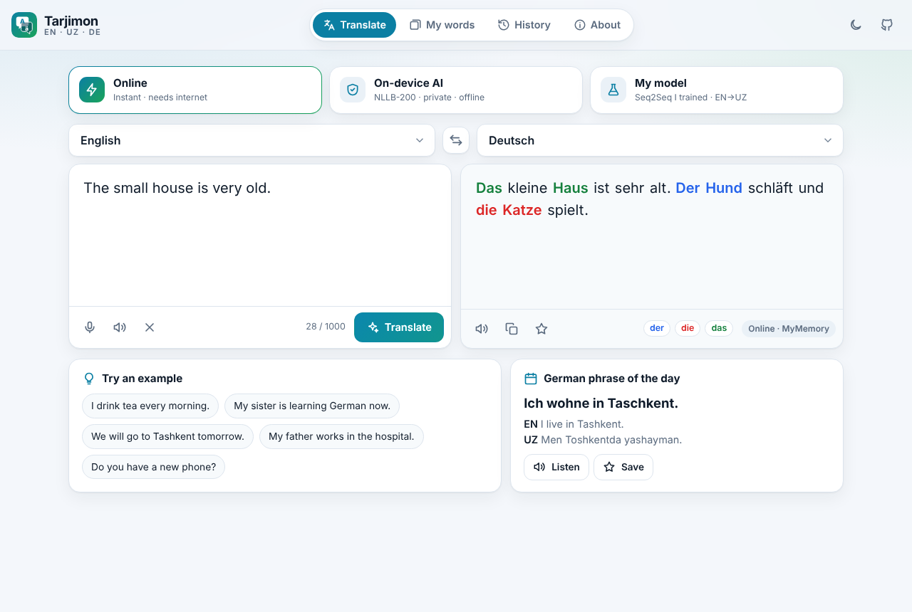
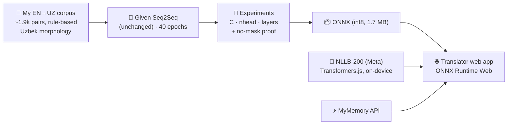
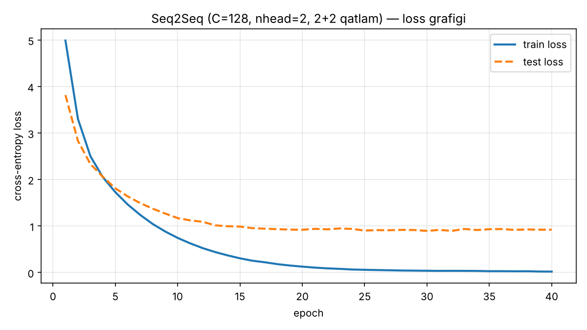
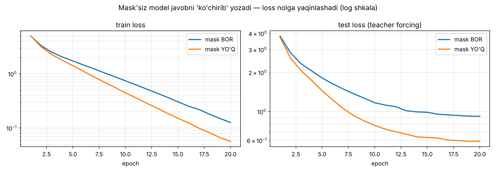
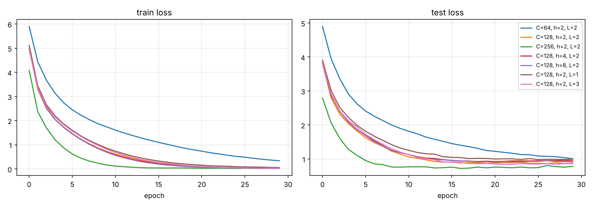

# 🌐 Translator — English ⇄ O'zbek ⇄ Deutsch

**A Seq2Seq Transformer I trained from scratch for EN→UZ, grown into a real in-browser translator I use to learn German.**


### 👉 [**Open the live app**](https://pearlm-457.github.io/Deep_Learning_Projects/translator/app/) · [Homework notebook](notebooks/Translator_Seq2Seq.ipynb) · <a href="https://colab.research.google.com/github/PearlM-457/Deep_Learning_Projects/blob/main/translator/notebooks/Translator_Seq2Seq.ipynb"></a>

<p align="center">
  
</p>

> 👆 German output is color-coded by noun gender (<b>der</b> 🔵 · <b>die</b> 🔴 · <b>das</b> 🟢). Tap any word to look it up in the other two languages, hear it, and save it as a flashcard.

---

## 🎯 Why I built this

- 📚 It started as a course assignment: *“Seq2Seq (Transformer) bilan Ingliz → O'zbek mini translator”*. Train the given Encoder–Decoder, build `tgt_in`/`tgt_out`, write `translate()`, run experiments.
- 🇩🇪 I'm learning German, so I didn't want a translator that only lives in a notebook. I wanted one I can **open on my phone every day**.
- 🧪 The goal was to learn the whole loop: build a dataset, train, evaluate honestly (BLEU/chrF), export it, and **ship it to the browser** with no server.

## 🗺️ How it works



The app has **three engines**:

| Engine | What runs | Languages | Why |
|---|---|---|---|
| ⚡ **Online** | MyMemory public API | EN ⇄ UZ ⇄ DE | instant, no download |
| 🛡️ **On-device AI** | Meta **NLLB-200** (600M, 8-bit) in a Web Worker via Transformers.js | EN ⇄ UZ ⇄ DE | private, **works offline** after a one-time download |
| 🧪 **My model** | **my** Seq2Seq Transformer, exported to ONNX | EN → UZ | the homework model, live; shows per-word confidence and unknown words |

## 📊 Results (test set, 10% held out)

| Model | BLEU | chrF | exact match |
|---|---:|---:|---:|
| Given `Seq2Seq` (C=128, 2 heads, 2+2 layers) + greedy, PyTorch | **66.7** | **83.4** | 47.8% |
| Same model, ONNX int8 (1.7 MB) in the browser | 66.3 | 83.4 | 47.3% |

<p align="center">
  
  
</p>

- **Left:** the given model learns fast, and the gap between train and test loss shows overfitting on a small dataset.
- **Right:** *the homework question, answered with an experiment.* Without the causal mask the decoder can see `tgt_in[i+1] == tgt_out[i]`, so it copies the answer. The loss collapses, **even on the test set**, yet `translate()` produces garbage because at inference time the future doesn't exist yet.

### 🔬 Experiments: `C`, `nhead`, layers

<p align="center"></p>

| C | nhead | layers | params | BLEU | chrF |
|---:|---:|---:|---:|---:|---:|
| 64 | 2 | 2 | 0.50M | 55.0 | 76.2 |
| 128 | 2 | 2 | 1.47M | 67.9 | 84.7 |
| **256** | 2 | 2 | 4.77M | **73.3** | **87.0** |
| 128 | 4 | 2 | 1.47M | 67.3 | 84.2 |
| 128 | 8 | 2 | 1.47M | 67.1 | 83.7 |
| 128 | 2 | 1 | 1.00M | 64.6 | 82.1 |
| 128 | 2 | 3 | 1.93M | 68.6 | 84.5 |

**Takeaways:** model width `C` matters most; more heads change almost nothing at this data size; every model overfits (train loss ≈ 0, test ≈ 0.8), so **more data** is the next big win.

## 🇩🇪 German-learning features

- 🎨 **der / die / das color-coding** of German nouns (the article colors the following noun, skipping adjectives)
- 👆 **Tap-a-word lookup** into the other two languages, plus pronunciation
- 🗂️ **Flashcards with spaced repetition** (Leitner boxes) and **Anki/CSV export**
- 🎤 **Voice input** and 🔊 **text-to-speech** (browser Web Speech API)
- 📅 **German phrase of the day**, 🕘 history, 🌙 dark mode
- 📱 **Installable PWA**. Everything (history, words) stays on your device.

## 🗂️ Repository layout

```
translator/
├── app/                      # the web app (static, served by GitHub Pages)
│   ├── index.html · styles.css · app.js
│   ├── js/engines.js         # online / NLLB / my-model engines, beam search in JS
│   ├── js/german.js          # gender coloring, phrases
│   ├── nllb-worker.js        # Transformers.js worker
│   ├── model/                # translator.onnx (int8) + vocab.json
│   └── sw.js · manifest.webmanifest · icons/
├── notebooks/Translator_Seq2Seq.ipynb   # ✅ the homework (Uzbek), fully executed
├── data/en_uz.tsv            # my EN→UZ dataset
├── scripts/make_dataset.py   # dataset generator (Uzbek morphology rules)
├── scripts/build_notebook.py # builds the notebook
└── assets/                   # plots & screenshots
```

## ▶️ Run it yourself

```bash
# web app (any static server)
cd app && python -m http.server 8000      # → http://localhost:8000

# rebuild the dataset / retrain
python scripts/make_dataset.py
# then open notebooks/Translator_Seq2Seq.ipynb (or click "Open in Colab")
```


## 🧭 Honest limitations & what's next

- 📉 **My model** knows ~1,400 words and only sentence patterns from my corpus. Outside them it guesses, and the app shows this with wavy underlines and an "unknown words" list.
- 🧩 Word-level tokens → next step: **BPE/SentencePiece** subwords plus real parallel data (Tatoeba / OPUS) to handle Uzbek agglutination.
- 🔁 Padding masks, label smoothing and beam search training (a V2 model), then fine-tune **NLLB-200** with LoRA and compare.
- 🎯 Attention-map visualizer in the app (encoder–decoder cross-attention).

## 🇺🇿 O'zbekcha qisqacha

**Translator** — kurs vazifasi sifatida boshlangan loyiha: berilgan Encoder–Decoder Transformer'ni o'zgartirmasdan o'qitdim, `tgt_in`/`tgt_out`ni tayyorladim, `translate()`ni yozdim va `C`, `nhead`, qatlamlar bilan tajriba o'tkazdim. Keyin modelni ONNX'ga o'tkazdim va brauzerda ishlaydigan haqiqiy translatorga aylantirdim: ingliz, o'zbek va nemis tillari, nemis tilini o'rganish uchun flashcard'lar va der/die/das ranglari bilan.

---

<sub>NLLB-200 © Meta AI (CC-BY-NC 4.0) · Online engine: MyMemory · Built with PyTorch, ONNX Runtime Web and Transformers.js · Made by PearlyMe</sub>
